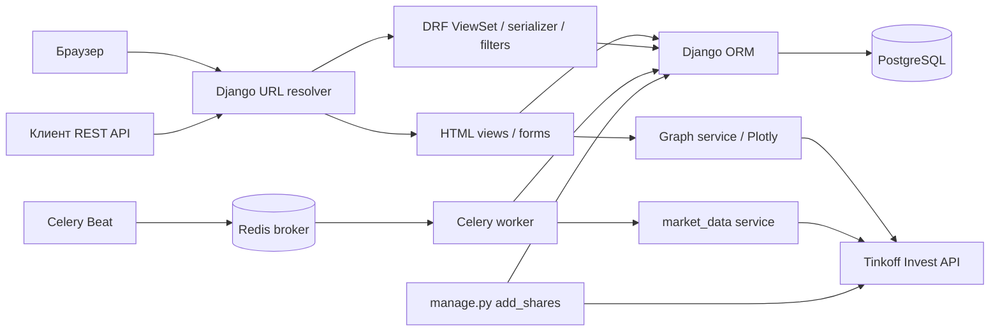

# Анализ исходного Investing Demo

## Границы анализа и доказательства

Документ выполняет задания №1–2 и описывает **исходную версию**, до модернизации и новой функциональности. Базовый коммит: `362510bf9eb10cfa88ac460647b4b5de20cc561e` (`main` на момент начала работы), одинаковый в `aidd-mcs/aidd-topic-03-homework` и выбранном форке. Ссылки ниже закреплены на этом коммите: номера строк не относятся к последующим изменениям.

Анализ выполнен чтением исходного кода и миграций. Наличие кода не означает, что все сценарии успешно работали в исходной конфигурации: препятствия и дефекты перечислены отдельно. Результаты запуска исправленной версии следует сверять с отчётом о проверках.

## 1. Назначение и технологический стек

Investing Demo — учебное приложение для просмотра общего каталога акций, их последних цен и графика дневных котировок. Зарегистрированный пользователь может изменять общий каталог через HTML. REST API предоставляет операции над акциями; фоновая задача получает последние цены из Tinkoff Invest API. В исходной версии нет персональных списков, портфелей, накопленной в БД истории цен и торговых стратегий.

| Компонент | Исходные версии / назначение | Доказательство |
| --- | --- | --- |
| Python / Django | Python-версия не закреплена; Django 4.1.7, серверные HTML-шаблоны, ORM, сессии, auth и admin | [requirements.txt:13](https://github.com/aidd-mcs/aidd-topic-03-homework/blob/362510bf9eb10cfa88ac460647b4b5de20cc561e/requirements.txt#L13), [settings.py:13](https://github.com/aidd-mcs/aidd-topic-03-homework/blob/362510bf9eb10cfa88ac460647b4b5de20cc561e/config/settings.py#L13) |
| REST | djangorestframework 3.14.0 и django-filter 22.1 | `requirements.txt:15–16`, `dashboard/api/v1/` |
| База данных | PostgreSQL, psycopg2-binary 2.9.5 | `settings.py:91–104`, `requirements.txt:27` |
| Фоновые задания | Celery 5.2.7, Redis-клиент 4.5.1, Redis в качестве брокера | `requirements.txt:7,31`, `settings.py:136–144` |
| Рыночные данные | tinkoff 0.1.1, tinkoff-investments 0.2.0b50, grpcio 1.51.3, protobuf 3.20.3, pydantic 1.10.6 | `requirements.txt:17,26,28,35–36` |
| Графики | Plotly 5.13.1, HTML div с JavaScript | `requirements.txt:24`, `dashboard/services/graph.py` |
| Формы и оформление | django-crispy-forms 2.0, crispy-bootstrap3 2022.1, локальный Bootstrap CSS; внешние JS/CSS в базовом шаблоне | `requirements.txt:12,14`, `dashboard/templates/dashboard/base.html` |
| Инструменты разработки | Black 23.1.0 и isort 5.12.0 смешаны с runtime-зависимостями | `requirements.txt:5,18` |
| Службы | Docker Compose поднимает только PostgreSQL и Redis, не Django/Celery | `docker-compose.yml` |

`requirements.txt` содержит также транзитивные зависимости Celery, Django, Plotly и SDK. Это плоский список закреплённых версий без разделения runtime/dev и без закрепления Python. PostgreSQL и Redis указаны как образы без тегов, поэтому их версии исходно невоспроизводимы. Конкретные обновления и результаты проверки совместимости должны документироваться отдельно от реконструкции исходного поведения.

## 2. Структура и архитектура

| Каталог / файл | Ответственность |
| --- | --- |
| `manage.py` | Точка входа команд Django: миграции, тесты, dev-сервер и пользовательские команды |
| `config/settings.py` | Приложения, middleware, шаблоны, PostgreSQL, REST-пагинация, логирование, токен API и настройки Celery |
| `config/urls.py` | Корневые маршруты: Django Admin, `dashboard`, `user` |
| `config/wsgi.py`, `config/asgi.py` | Вход для WSGI/ASGI-сервера |
| `config/celery.py` | Celery app, autodiscovery и расписание обновления цен |
| `dashboard/models.py`, `dashboard/migrations/` | Единственная предметная сущность `Share`, семь последовательных миграций |
| `dashboard/views.py`, `forms.py`, `templates/`, `static/` | HTML-каталог, карточка с графиком, CRUD-формы и оформление |
| `dashboard/api/v1/` | DRF ViewSet, сериализатор, фильтры и DefaultRouter для `/api/v1/shares/` |
| `dashboard/services/` | Синхронные обращения в Tinkoff API за последними ценами и свечами, построение Plotly-графика |
| `dashboard/tasks.py` | Периодическое обновление последних цен акций |
| `dashboard/management/commands/add_shares.py` | Первоначальная загрузка справочника инструментов |
| `dashboard/admin.py` | Регистрация модели акций в Django Admin |
| `dashboard/tests.py` | 10 существующих API/HTML-тестов; нет тестов аутентификации и внешнего API |
| `user/` | Регистрация, вход, выход; `User` — псевдоним стандартной модели Django, не новая таблица |

Это монолит Django с серверным HTML и параллельным JSON API. Представления используют Django ORM напрямую; интеграция с рынком вынесена в два сервисных модуля. Celery — отдельный процесс, использующий те же Django-настройки и БД; Redis передаёт задачи. Отдельного клиентского приложения и отдельных бизнес-сервисов нет.

### Обработка запросов и доступа

1. Middleware обслуживают безопасность, сессии, CSRF, пользователя, сообщения и защиту от iframe (`settings.py:61–69`). Стандартный auth backend используется без переопределения.
2. HTML-запрос попадает в generic view или обычный `View`; ORM загружает `Share`; шаблон формирует ответ. `ModelForm` валидирует ввод и ограничения полей при HTML CRUD. После успешного изменения выполняется redirect на главную.
3. API-запрос проходит через DefaultRouter в `ModelViewSet`; сериализатор проверяет объявленные поля и ограничения модели, ORM выполняет операцию, DRF возвращает JSON и статус. Фильтры применяются к queryset до пагинации.
4. Регистрация создаёт стандартного Django-пользователя, затем выполняет вход через сессию. HTML CRUD использует `UserPassesTestMixin`, проверяя только факт входа. Разделения ролей/владельцев акций нет.
5. Карточка акции синхронно запрашивает дневные свечи внешнего API, поэтому доступность провайдера влияет на HTTP-ответ.
6. Beat ставит `dashboard.tasks.update_last_price` в Redis каждые 10 секунд; worker последовательно обращается к внешнему API для каждой акции и обновляет её строку. Необходимость запуска обоих процессов отражена в README.

## 3. Модель данных

### Предметная сущность `Share`

Источник: [dashboard/models.py:4](https://github.com/aidd-mcs/aidd-topic-03-homework/blob/362510bf9eb10cfa88ac460647b4b5de20cc561e/dashboard/models.py#L4); реальное создание PK — `migrations/0001_add_share.py:12–29`, последующие ограничения и поля — миграции `0002`–`0007`.

| Атрибут | Тип / ограничения | Назначение |
| --- | --- | --- |
| `id` | `BigAutoField`, PK, автоматически | Локальный идентификатор акции |
| `figi` | `CharField(255)`, unique, обязательный | Идентификатор инструмента во внешнем API |
| `isin` | `CharField(255)`, обязательный, не unique | ISIN |
| `name` | `CharField(255)`, обязательный | Название компании |
| `ticker` | `CharField(10)`, unique, обязательный | Тикер |
| `currency` | `CharField(20)`, обязательный | Валюта; справочник/enum не задан |
| `uid` | `CharField(255)`, unique, обязательный в модели/HTML-форме | UID провайдера; ошибочно отсутствует в исходном API-сериализаторе |
| `last_price` | `FloatField`, null/blank | Последняя известная цена; точной десятичной арифметики нет |
| `is_trend_high` | `BooleanField`, null/blank | Направление относительно ранее сохранённой цены |
| `updated_at` | `DateTimeField(auto_now=True)`, null/blank в модели | Время сохранения через `save`; фоновый `update` его исходно не обновляет |

`Share` не содержит внешних ключей. Все акции образуют **общий каталог**, не принадлежат конкретному пользователю. Исторические свечи не сохраняются: при просмотре карточки их повторно получает внешний сервис.

### Стандартные сущности Django

`user/models.py:1–3` вызывает `get_user_model()`, `AUTH_USER_MODEL` не переопределён. Поэтому используется стандартный `auth.User`: PK `id`, уникальный `username`, `password` с хешем, `email`, `first_name`, `last_name`, `is_active`, `is_staff`, `is_superuser`, `last_login`, `date_joined`; связи many-to-many с группами и разрешениями. Приложение задаёт `username = email` при регистрации. Поле `email` стандартной модели само по себе не unique; проверку выполняет только форма.

Из установленных Django-приложений также создаются служебные таблицы сессий, типов контента, разрешений, групп и журнала административных действий. Предметных связей `User → Share` нет. Redis — брокер, не хранилище предметных сущностей. Изменение модели пользователей или добавление новых финансовых сущностей не является реконструкцией исходной модели.

## 4. Восстановленные функциональные требования

Ниже описаны операции, подтверждаемые исходным кодом. Ошибки выполнения и противоречия доступа вынесены в раздел 6 и не считаются требованиями. Для каждой ссылки используется исходный коммит.

1. **FR-01. Публичный каталог.** Посетитель может открыть `/` и получить HTML-список акций, упорядоченный по `name`, с пагинацией по 100 записей. Источник: [dashboard/views.py:20–26, ShareListView](https://github.com/aidd-mcs/aidd-topic-03-homework/blob/362510bf9eb10cfa88ac460647b4b5de20cc561e/dashboard/views.py#L20), `dashboard/urls.py:14`.
2. **FR-02. Поля каталога и навигация.** Строка списка показывает тикер со ссылкой на карточку, название, ISIN, цену и валюту; при пустом каталоге выводится «Акций еще нет». Источник: [list.html:15–40,83–85](https://github.com/aidd-mcs/aidd-topic-03-homework/blob/362510bf9eb10cfa88ac460647b4b5de20cc561e/dashboard/templates/dashboard/list.html#L15).
3. **FR-03. Цвет направления.** Список визуально обозначает направление изменения цены по `is_trend_high` (зелёный при true, альтернативный цвет иначе). Источник: [list.html:35–40](https://github.com/aidd-mcs/aidd-topic-03-homework/blob/362510bf9eb10cfa88ac460647b4b5de20cc561e/dashboard/templates/dashboard/list.html#L35). Отдельное состояние «цена неизвестна» исходно не реализовано.
4. **FR-04. Карточка.** Посетитель открывает `/<id>` и видит название, последнюю сохранённую цену, валюту и `updated_at`. Источник: [ShareDetailView.get, views.py:29–38](https://github.com/aidd-mcs/aidd-topic-03-homework/blob/362510bf9eb10cfa88ac460647b4b5de20cc561e/dashboard/views.py#L29), [detail.html:11–13](https://github.com/aidd-mcs/aidd-topic-03-homework/blob/362510bf9eb10cfa88ac460647b4b5de20cc561e/dashboard/templates/dashboard/detail.html#L11).
5. **FR-05. Рыночный график.** Карточка получает дневные свечи по FIGI за последние 180 дней и строит линейный график цен закрытия с датой по оси X. Источник: [graph.py:11–36, get_graph](https://github.com/aidd-mcs/aidd-topic-03-homework/blob/362510bf9eb10cfa88ac460647b4b5de20cc561e/dashboard/services/graph.py#L11). Настраиваемого периода и сохранения этих свечей в БД нет; потеря дробной части — дефект D-06.
6. **FR-06. Создание через HTML.** Вошедший пользователь открывает `/create`, отправляет форму акции и после успешного сохранения возвращается на главную. Источник: [views.py:11–17,41–46](https://github.com/aidd-mcs/aidd-topic-03-homework/blob/362510bf9eb10cfa88ac460647b4b5de20cc561e/dashboard/views.py#L41), `dashboard/forms.py:6–11`, `create.html:13–18`.
7. **FR-07. Редактирование через HTML.** Вошедший пользователь открывает `/update/<id>`, изменяет поля акции и после сохранения возвращается на главную. Источник: [views.py:49–55, ShareUpdateView](https://github.com/aidd-mcs/aidd-topic-03-homework/blob/362510bf9eb10cfa88ac460647b4b5de20cc561e/dashboard/views.py#L49), `dashboard/urls.py:17`.
8. **FR-08. Удаление через HTML.** Вошедший пользователь открывает `/delete/<id>`, видит имя акции в подтверждении и удаляет её POST-запросом, после чего возвращается на главную. Источник: [views.py:58–63, ShareDeleteView](https://github.com/aidd-mcs/aidd-topic-03-homework/blob/362510bf9eb10cfa88ac460647b4b5de20cc561e/dashboard/views.py#L58), [delete.html:9–12](https://github.com/aidd-mcs/aidd-topic-03-homework/blob/362510bf9eb10cfa88ac460647b4b5de20cc561e/dashboard/templates/dashboard/delete.html#L9).
9. **FR-09. Доступ к HTML-изменениям.** HTML-формы создания, редактирования и удаления доступны после входа; анонимный запрос перенаправляется на каталог. Кнопки изменения показываются только вошедшему пользователю. Источник: [views.py:11–17](https://github.com/aidd-mcs/aidd-topic-03-homework/blob/362510bf9eb10cfa88ac460647b4b5de20cc561e/dashboard/views.py#L11), `list.html:9–13,41–50`.
10. **FR-10. Проверки полей акции.** При вводе через ModelForm действуют типы, длины, обязательность полей и уникальность FIGI/тикера/UID из модели. Цена и признак направления могут быть пустыми. Источник: [forms.py:6–11](https://github.com/aidd-mcs/aidd-topic-03-homework/blob/362510bf9eb10cfa88ac460647b4b5de20cc561e/dashboard/forms.py#L6), `models.py:7–17`. Проверки положительности цены, формата идентификаторов и перечня валют в исходнике отсутствуют.
11. **FR-11. API списка и карточки.** REST-клиент получает коллекцию через `GET /api/v1/shares/` и объект через `GET /api/v1/shares/<id>/`. Источник: [router.py:5–6](https://github.com/aidd-mcs/aidd-topic-03-homework/blob/362510bf9eb10cfa88ac460647b4b5de20cc561e/dashboard/api/v1/router.py#L5), [ShareViewSet, views.py:16–22](https://github.com/aidd-mcs/aidd-topic-03-homework/blob/362510bf9eb10cfa88ac460647b4b5de20cc561e/dashboard/api/v1/views.py#L16), `dashboard/api/urls.py:3–5`.
12. **FR-12. API изменения.** ViewSet предоставляет создание POST, полное обновление PUT, частичное PATCH и удаление DELETE. Источник: [views.py:16, ModelViewSet](https://github.com/aidd-mcs/aidd-topic-03-homework/blob/362510bf9eb10cfa88ac460647b4b5de20cc561e/dashboard/api/v1/views.py#L16), `router.py:5–6`. Вопрос анонимной записи — D-03, не требование разрешить небезопасный доступ.
13. **FR-13. Представление API.** Сериализуемые поля исходной версии: `id`, `figi`, `isin`, `name`, `ticker`, `currency`, `last_price`, `is_trend_high`, `updated_at`. Источник: [serializer.py:6–19, ShareSerializer](https://github.com/aidd-mcs/aidd-topic-03-homework/blob/362510bf9eb10cfa88ac460647b4b5de20cc561e/dashboard/api/v1/serializer.py#L6). Пропуск `uid` фиксируется как D-04, а не как желаемое ограничение.
14. **FR-14. API-фильтрация.** Параметры `name` и `ticker` фильтруют по точному значению, `ordering` сортирует по `name`/`ticker` (в том числе в обратном направлении), `search` выполняет regex-поиск по имени через префикс `$`. Источник: [views.py:10–22, ShareFilter и ShareViewSet](https://github.com/aidd-mcs/aidd-topic-03-homework/blob/362510bf9eb10cfa88ac460647b4b5de20cc561e/dashboard/api/v1/views.py#L10).
15. **FR-15. API-пагинация.** Коллекция использует LimitOffsetPagination с размером страницы по умолчанию 100 и параметрами `limit`, `offset`. Источник: [settings.py:31–35](https://github.com/aidd-mcs/aidd-topic-03-homework/blob/362510bf9eb10cfa88ac460647b4b5de20cc561e/config/settings.py#L31).
16. **FR-16. Ошибки API.** Для несуществующей акции detail возвращает 404; невалидные обязательные поля создания/полного обновления — 400. Источник: `ModelViewSet`/`ModelSerializer` в [views.py:16–18](https://github.com/aidd-mcs/aidd-topic-03-homework/blob/362510bf9eb10cfa88ac460647b4b5de20cc561e/dashboard/api/v1/views.py#L16), [tests.py:54–56,78–89,105–109](https://github.com/aidd-mcs/aidd-topic-03-homework/blob/362510bf9eb10cfa88ac460647b4b5de20cc561e/dashboard/tests.py#L54).
17. **FR-17. Регистрация.** Посетитель заполняет email и два пароля; при валидных данных создаётся стандартный пользователь с email в полях `username` и `email`, затем пользователь входит и перенаправляется на каталог. Источник: [RegistrationForm.save, forms.py:48–53](https://github.com/aidd-mcs/aidd-topic-03-homework/blob/362510bf9eb10cfa88ac460647b4b5de20cc561e/user/forms.py#L48), [RegistrationView.post, views.py:44–49](https://github.com/aidd-mcs/aidd-topic-03-homework/blob/362510bf9eb10cfa88ac460647b4b5de20cc561e/user/views.py#L44).
18. **FR-18. Проверки регистрации.** Форма требует корректный email, два непустых совпадающих пароля и отсутствие пользователя с тем же email. Для несовпадения паролей/занятого email выводится сообщение. Источник: [forms.py:11–46, RegistrationForm](https://github.com/aidd-mcs/aidd-topic-03-homework/blob/362510bf9eb10cfa88ac460647b4b5de20cc561e/user/forms.py#L11), `user/views.py:50–55`. Регистронезависимость и применение password validators исходно не обеспечены (D-05).
19. **FR-19. Вход.** Посетитель вводит email и пароль; при успешном `authenticate` создаётся сессия и открывается каталог, при неверной паре выводится «Неверный логин или пароль! Повторите попытку.». Источник: [AuthView.post, views.py:16–33](https://github.com/aidd-mcs/aidd-topic-03-homework/blob/362510bf9eb10cfa88ac460647b4b5de20cc561e/user/views.py#L16).
20. **FR-20. Выход.** Пользователь может завершить сессию и вернуться к каталогу. Источник: [LogoutView.get, views.py:58–64](https://github.com/aidd-mcs/aidd-topic-03-homework/blob/362510bf9eb10cfa88ac460647b4b5de20cc561e/user/views.py#L58). Изменение состояния через GET — отдельно D-12.
21. **FR-21. Импорт справочника.** Команда `python manage.py add_shares` запрашивает `client.instruments.shares()` и сохраняет для каждого инструмента FIGI, name, ISIN, ticker, currency и UID. Источник: [Command.handle, add_shares.py:11–22](https://github.com/aidd-mcs/aidd-topic-03-homework/blob/362510bf9eb10cfa88ac460647b4b5de20cc561e/dashboard/management/commands/add_shares.py#L11). Импорт полного совпадения не создаёт повторную строку; обновление изменившихся реквизитов исходно ненадёжно (D-08).
22. **FR-22. Фоновое получение последних цен.** При запущенных Redis, Beat и worker задача обходит каталог и запрашивает последнюю цену отдельно для каждого FIGI, затем сохраняет её в `last_price`. Источник: [tasks.py:7–28, update_last_price](https://github.com/aidd-mcs/aidd-topic-03-homework/blob/362510bf9eb10cfa88ac460647b4b5de20cc561e/dashboard/tasks.py#L7), [market_data.py:6–11](https://github.com/aidd-mcs/aidd-topic-03-homework/blob/362510bf9eb10cfa88ac460647b4b5de20cc561e/dashboard/services/market_data.py#L6), [celery.py:13–18](https://github.com/aidd-mcs/aidd-topic-03-homework/blob/362510bf9eb10cfa88ac460647b4b5de20cc561e/config/celery.py#L13).
23. **FR-23. Расчёт направления цены.** Новая цена ниже сохранённой устанавливает `is_trend_high=False`; равная или более высокая — true. Источник: [tasks.py:15–25](https://github.com/aidd-mcs/aidd-topic-03-homework/blob/362510bf9eb10cfa88ac460647b4b5de20cc561e/dashboard/tasks.py#L15). Для отсутствующей прежней цены используется обработчик исключения, что отмечено в D-07.
24. **FR-24. Изоляция ошибок котировок.** Ошибка обработки отдельной акции записывается в лог, после чего цикл может обработать остальные акции. Источник: [tasks.py:11–28](https://github.com/aidd-mcs/aidd-topic-03-homework/blob/362510bf9eb10cfa88ac460647b4b5de20cc561e/dashboard/tasks.py#L11), `settings.py:37–59`.
25. **FR-25. Администрирование.** Пользователь с правами Django Admin может управлять акциями в `/admin/`, видеть FIGI, ISIN, name, ticker, currency в списке и искать по FIGI/ISIN/name/ticker. Источник: [ShareAdmin, admin.py:6–19](https://github.com/aidd-mcs/aidd-topic-03-homework/blob/362510bf9eb10cfa88ac460647b4b5de20cc561e/dashboard/admin.py#L6), `config/urls.py:5`, стандартная авторизация Django Admin.

## 5. Основные пользовательские сценарии и правила

| Сценарий | Последовательность | Реализованные правила |
| --- | --- | --- |
| Просмотр рынка | Открыть каталог → страницу списка → карточку акции | Общий каталог; сортировка по имени; по 100 строк; график требует внешнего сервиса |
| Работа с каталогом | Зарегистрироваться/войти → создать или отредактировать акцию → сохранить → каталог | Любой вошедший HTML-пользователь работает с общими акциями; уникальны FIGI, ticker, UID; нет понятия владельца |
| Удаление акции | Войти → открыть подтверждение → отправить POST | GET показывает подтверждение, удаляет POST; после операции redirect |
| REST-интеграция | GET коллекции с фильтрами → GET объекта → POST/PUT/PATCH/DELETE | Применяются поля исходного сериализатора и модельные ограничения; права записи противоречивы |
| Начальное наполнение | Настроить токен и БД → `add_shares` | Список инструментов запрашивается целиком; совпадающая строка повторно не создаётся |
| Автоматическое обновление | Запустить Redis → worker → Beat → дождаться задачи | Интервал фактически 10 секунд; цена/направление перезаписываются; отдельные снимки не сохраняются |
| Регистрация и сессия | Заполнить email/пароли → проверка → создание пользователя → вход | Пароли должны совпасть; email проверяется формой; штатная сессия Django |

Отсутствуют комиссии, операции покупки/продажи, баланс, владение активами, уведомления, критерии стратегий и расчёт доходности. Их нельзя представлять как восстановленные требования. `last_price` не является историей котировок; `is_trend_high` — только сравнение двух последних известных цен, не аналитический тренд.

## 6. Неоднозначности, противоречия и дефекты исходной реализации

Эта таблица — результат статического аудита. Она не превращает ошибочное поведение в функциональные требования и не подменяет результаты фактических тестов.

| ID | Наблюдение и последствия | Подтверждение в исходном коде |
| --- | --- | --- |
| D-01 | `SECRET_KEY` пуст: операции, требующие подписи/сессий, не имеют пригодной конфигурации. `DEBUG=True`, локальные реквизиты БД и пустой токен жёстко заданы; нет чтения окружения | `config/settings.py:6–10,91–104,134` |
| D-02 | Стек закреплён на версиях 2022–2023 гг., версия Python не закреплена; PostgreSQL/Redis используют плавающие теги. Установка и современная совместимость требуют проверки, а не предположения | `requirements.txt`, `docker-compose.yml:4,17` |
| D-03 | HTML запрещает анонимное изменение акций, API не задаёт permissions и наследует стандартный `AllowAny`. Анонимный клиент может обойти ограничение HTML. Исходные тесты даже выполняют запись без входа | `dashboard/views.py:11–17`, `dashboard/api/v1/views.py:16–22`, `config/settings.py:31–35`, `dashboard/tests.py:91–118` |
| D-04 | Уникальный обязательный `uid` исключён из сериализатора. Переданный UID игнорируется; первая запись может получить пустую строку, последующая — конфликт UNIQUE. Тест одного создания это не обнаруживает | `dashboard/models.py:12`, `dashboard/api/v1/serializer.py:9–19`, `dashboard/tests.py:91–103` |
| D-05 | `RegistrationForm.clean` напрямую обращается к `cleaned_data[...]`, хотя поле могло не пройти валидацию; view ожидает только `__all__`. Невалидный email/пустые поля могут дать KeyError/500. Вход также читает raw POST без `is_valid`. Email при входе приводится к lowercase, при регистрации — нет; проверки пароля из settings формой не вызываются | `user/forms.py:30–53`, `user/views.py:16–19,50–55`, `config/settings.py:106–119` |
| D-06 | Котировки и close свечей берут только `units`, игнорируя `nano`: теряется дробная часть цены. `FloatField` дополнительно не гарантирует точной десятичной арифметики | `dashboard/services/market_data.py:11`, `dashboard/services/graph.py:20`, `dashboard/models.py:13` |
| D-07 | `QuerySet.update` не вызывает `auto_now`; задача не записывает время провайдера, поэтому `updated_at` не показывает время обновления котировки. Сравнение `None` с ценой используется как штатное исключение; равенство обозначается как рост | `dashboard/tasks.py:13–25`, `dashboard/models.py:17` |
| D-08 | `get_or_create` ищет по всем реквизитам, а не стабильному идентификатору. Изменение названия/валюты при том же FIGI приводит к попытке вставки и конфликту unique; импорт не обновляет метаданные | `dashboard/management/commands/add_shares.py:15–22` |
| D-09 | HTML-карточка использует `.get()` без 404-обработки; отсутствие акции или сбой провайдера пробрасывается в 500. Внешний API вызывается синхронно и без локального fallback | `dashboard/views.py:31–37`, `dashboard/services/graph.py:11–20` |
| D-10 | Название расписания `add-every-5-min` не соответствует интервалу `10.0` секунд. Нет флага для отключения интеграции при отсутствии токена; нет защиты от перекрывающихся запусков | `config/celery.py:13–18`, `dashboard/tasks.py:7–28` |
| D-11 | Корневой префикс `path("user", ...)` без `/` создаёт реальные URL `/userlogin/`, `/userregistration/`, `/userlogout/`. Внутренний reverse работает, но привычные `/user/login/` не существуют | `config/urls.py:7`, `user/urls.py:8–10` |
| D-12 | Выход изменяет сессию GET-запросом; это допускает непреднамеренный выход при открытии ссылки | `user/views.py:58–64` |
| D-13 | Уникальность email проверяется только формой, регистр не нормализуется, атомарного ограничения email нет. Исходная `User.email` не unique; конкурентная регистрация требует обработки уникальности username | `user/forms.py:39–52`, `user/models.py:1–3` |
| D-14 | Семантика направления не различает равенство, отсутствие цены и падение в UI; `None` отображается альтернативным цветом. Положительность цены, корректность FIGI/ISIN и перечень валют не проверяются | `dashboard/templates/dashboard/list.html:35–40`, `dashboard/models.py:7–17` |
| D-15 | Миграция UID добавляет одинаковое значение `""` с unique; перенос уже заполненной БД с несколькими акциями может потребовать отдельной data migration | `dashboard/migrations/0003_add_uuid.py:12–16` |
| D-16 | В API нет устойчивой сортировки по умолчанию; пагинация queryset без ordering может быть нестабильной. Поиск `$name` означает регулярное выражение, что не очевидно пользователю | `dashboard/api/v1/views.py:18–22` |
| D-17 | Тесты покрывают 10 примеров API/списка, но не регистрацию, HTML CRUD, графики, импорт, точность, задачи и многопользовательский доступ. `updated_at` имеет `blank=True` в модели, но не в последней миграции — возможный дрейф состояния миграций | `dashboard/tests.py`, `dashboard/models.py:17`, `dashboard/migrations/0007_add_updated_at.py:15` |

Отдельные продуктовые решения требуют явного описания при модернизации: должен ли общий каталог редактироваться любым вошедшим пользователем или только администратором; равная цена означает «не падает» или отдельное нейтральное состояние; как действовать при недоступном источнике котировок. Исходник не даёт оснований приписывать ему персональное владение каталогом, гарантированную частоту свежих котировок или финансовую точность.

## 7. Основа проверки сохранения функциональности

Минимальные регрессионные проверки после исправлений: публичный список/карточка/пагинация; HTML CRUD после входа и запрет анонимной записи; API CRUD, уникальность всех трёх идентификаторов и фильтры; валидная/невалидная регистрация и вход; штатный выход; отсутствие акции → 404; повторный импорт и изменение реквизитов; дробная котировка, обновление времени, изоляция ошибки одной акции; график и корректный ответ при недоступном внешнем сервисе.

Интеграцию с реальным рынком необходимо отделять от тестов с контролируемым провайдером. Mock-проверка формата котировки не подтверждает доступ к внешнему API. Запуск Celery worker без исполнения задачи не подтверждает работу фонового обновления. Итоговые числа тестов и фактические HTTP-результаты должны отражать только выполненные проверки.
