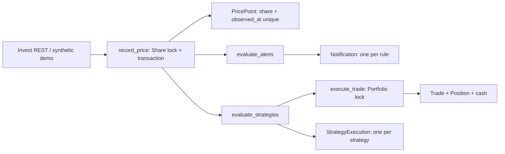

# Задание №4: требования и реализация

Реализованы все четыре перечисленных направления. Данные демонстрации синтетические, реальные заявки брокеру не отправляются. Требования ниже относятся к новой функциональности и не смешиваются с восстановленными требованиями исходной версии.

## Новые функциональные требования

1. **NF-01. Личные списки.** Вошедший пользователь создаёт несколько именованных списков; имена уникальны в его пределах. Просмотр и изменение чужих списков недоступны.
2. **NF-02. Целевые уровни.** В списке можно выбрать акцию, положительный порог и условие «цена не ниже»/«цена не выше». Граница включается. Числа проверяются до сохранения.
3. **NF-03. Уведомление.** При новой подходящей котировке система сохраняет уведомление во внутреннем inbox владельца: тикер, валюта, целевая/наблюдаемая цена и время. Можно отметить прочитанным.
4. **NF-04. Отсутствие дублей.** Каждое правило срабатывает один раз; повторные и одновременные обработки не создают дубли. Для нового события пользователь создаёт новое правило. Удаление правила не стирает доставленное уведомление.
5. **NF-05. Портфель.** Пользователь создаёт личные портфели с названием, валютой и неотрицательным начальным виртуальным капиталом. Чужие портфели недоступны.
6. **NF-06. Сделки.** Покупка/продажа принимает положительное количество и исполняется по последней сохранённой цене. Отсутствие цены, несовпадение валют, недостаток средств или акций запрещает сделку без частичных изменений.
7. **NF-07. Учёт.** Покупка пересчитывает средневзвешенную цену; частичная продажа сохраняет её для остатка, полная обнуляет. Денежные величины Decimal, округление HALF_UP до 9 знаков; комиссий нет.
8. **NF-08. История и P&L.** Каждая сделка оставляет запись времени, типа, акции, количества, цены и реализованного результата. UI показывает позиции, стоимость, свободный капитал, реализованный/нереализованный и общий P&L; история пагинируется. При неизвестной котировке оценка неизвестна, а не ноль. Разные валюты не суммируются.
9. **NF-09. Конкурентность.** Одновременные сделки не могут перерасходовать капитал или продать лишние акции. Повторный внутренний idempotency key не создаёт вторую сделку; конфликт параметров отклоняется.
10. **NF-10. Накопление цен.** Каждая принятая котировка хранится с акцией, точной ценой и aware-временем. Пара акция+время уникальна. Повтор того же значения не меняет состояние; другая цена на том же времени отклоняется.
11. **NF-11. Актуальность.** Запоздавшая котировка пополняет историю, но не откатывает последнюю цену и не запускает текущие уведомления/стратегии. Изменение реквизитов акции не меняет время последней цены.
12. **NF-12. Анализ периода.** Карточка принимает даты начала/конца (UTC), показывает таблицу и график сохранённых цен; неверный диапазон даёт ошибку. Абсолютное/процентное изменение считается между первым и последним наблюдением периода; при менее двух точек не вычисляется, при нулевой начальной цене процент неизвестен. Внешние дневные свечи доступны отдельным источником при токене.
13. **NF-13. Стратегия.** Пользователь создаёт личное одноразовое правило для своего портфеля: акция, количество, порог и сторона. Покупка срабатывает при цене ≤ порога, продажа — ≥ порога. Условия и количество задаются через UI.
14. **NF-14. Автоматическая симуляция.** Новая котировка вызывает проверку правил. Стратегия исполняет виртуальную сделку через тот же транзакционный портфель; одно правило не создаёт повторных сделок при повторной/конкурентной обработке.
15. **NF-15. Журнал и управление.** Владелец видит ожидающие/исполненные/ошибочные/отменённые стратегии, время/цену и сделку либо причину отказа. Ожидающую стратегию можно отменить. Ошибка недостатка средств/акций фиксируется и завершает правило; автоматического бесконечного повтора нет.
16. **NF-16. Эффективность.** Для продажи показывается реализованный результат; для покупки — явно обозначенное гипотетическое изменение стоимости первоначального лота и процент (без учёта будущих продаж). Фактический совокупный результат хранится в портфеле. Это пороговый симулятор, не исторический бэктест.
17. **NF-17. Безопасные изменения.** Все персональные страницы требуют входа, запросы ограничены владельцем, изменения используют POST и CSRF. Публичное чтение общего каталога не раскрывает персональные объекты.

## Архитектура и модель данных

- `PricePoint → Share`: несколько наблюдений на акцию; `Share.last_price` — последнее, `updated_at` — время котировки.
- `Watchlist → User`, `WatchRule → Watchlist/Share`, `Notification → User/WatchRule`: уникальность правила доставки на уровне БД; snapshot сообщения переживает удаление правила.
- `Portfolio → User`, `Position → Portfolio/Share` (одна позиция на пару), `Trade → Portfolio/Share`: Decimal-поля, проверки положительности, уникальный ключ внутренней операции, ограничения удаления используемой акции.
- `Strategy → User/Portfolio/Share`, `StrategyExecution → Strategy/Trade`: одноразовый автомат состояний pending → executed/failed/cancelled.

Проверки пользователя выполняются во views/forms, доменные инварианты — в сервисах, уникальность и неотрицательные остатки дополнительно закреплены constraints БД. Операции с портфелем блокируют строку Portfolio, что сериализует операции пользователя. Запись цены, уведомления и стратегии объединены транзакцией: инфраструктурный сбой откатывает пакет, бизнес-отказ стратегии записывается в журнал. Live-процесс запускается Beat раз в 60 секунд; повторные котировки дедуплицируются. Отдельные конкурентные тесты выполняются на PostgreSQL.

Реализация и локальные требования модулей: [monitoring](../monitoring/README.md), [portfolio](../portfolio/README.md), [strategies](../strategies/README.md). Проверки — [VALIDATION.md](VALIDATION.md).
